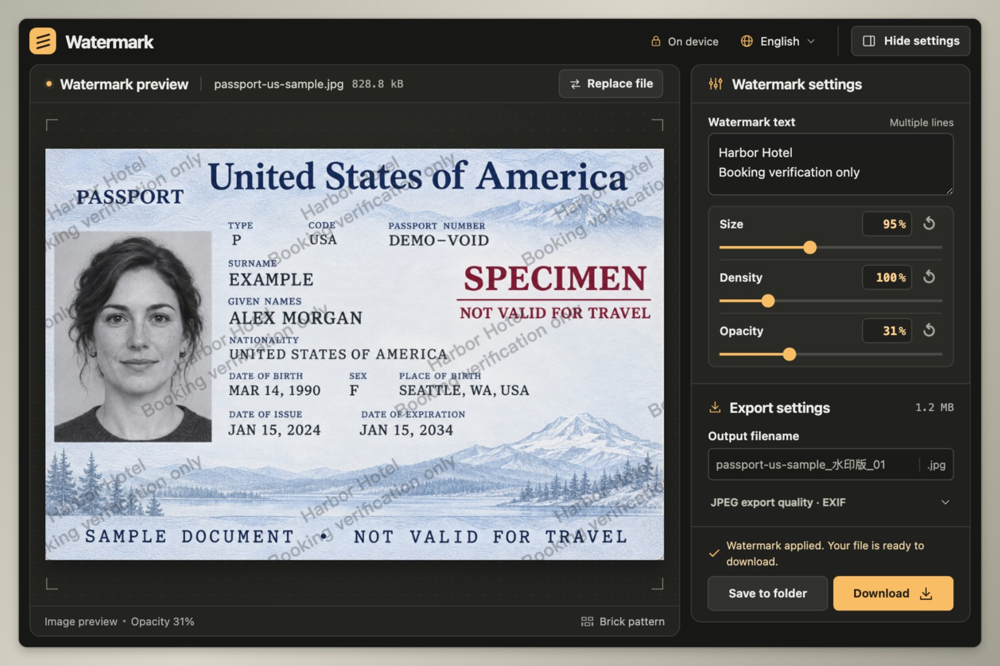
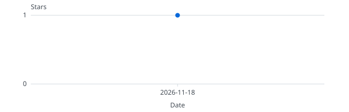

<h1 align="center"> Offline Watermark Tool for PDFs and JPEGs</h1>

<p align="center"><strong>Add tiled text watermarks to JPEG images or every page of a PDF in your browser.</strong><br>
Your files stay on your device. Open the editor online, or download one HTML file and use it offline.</p>

<p align="center">
  <strong><a href="https://kinoward.github.io/offline-watermark/">Open the editor</a></strong> ·
  <a href="https://github.com/kinoward/offline-watermark/releases/latest/download/Watermark.html">Download offline HTML</a> ·
  <a href="#implementation-guide">Explore the implementation</a>
</p>

<p align="center"><strong>English</strong> · <a href="README.zh-CN.md" lang="zh-CN">简体中文指南 · 在浏览器本地给 PDF 和 JPG 图片加水印，支持离线使用</a></p>

<p align="center">
  <a href="#contributors"></a>
  <a href="#star-history"></a>
</p>

<p align="center">
  <a href="https://github.com/kinoward/offline-watermark/releases/latest"></a>
  <a href="#quick-start"></a>
  <a href="#license"></a>
  <br>
  <a href="#export-details"></a>
  <a href="docs/en/architecture.md"></a>
  <a href="#privacy-and-languages"></a>
</p>

## Quick start

Try the controls on the built-in preview. To export the example below yourself, save the AI-generated sample JPEG and open it in the editor. [Save the sample JPEG](docs/assets/passport-us-sample.jpg?raw=true)

1. **Add file.** Choose one JPG, JPEG or PDF. To work offline, double-click the downloaded `Watermark.html` first.
2. **Set the text.** For the example, enter `Harbor Hotel` on the first line and `Booking verification only` on the second. Adjust size, density and opacity in the preview.
3. **Apply watermark → Download.** Keep the suggested name, such as `passport-us-sample_水印版_01.jpg`, or choose your own. Browsers with directory access also offer **Save to folder**.

[](https://kinoward.github.io/offline-watermark/)

<p align="center"><em>A traveler marks a passport copy for a single hotel booking.</em> · <a href="docs/assets/watermark-comparison-en.jpg">Compare the original and the export</a></p>

Star this repository if you’d like to find the offline editor or its PDF and JPEG code again.

### Using the editor on different devices

- **Desktop.** Drag a file into the preview to open it. [Desktop screenshot](docs/assets/desktop-en.jpg)
- **Tablet.** Turn PDF pages with the watermark settings in view. [Tablet screenshot](docs/assets/tablet-en.jpg)
- **Phone.** Tap the compact preview to enlarge it. [Phone screenshot](docs/assets/phone-en.jpg)

<a name="how-it-works"></a>

## Implementation guide

- **How do I watermark every PDF page and keep the text searchable?** pdf-lib adds a transparent image tile to each page. The overlay follows the page rotation and clips to the visible area. Existing text stays selectable and the original image streams are preserved. [PDF overlay](src/pdf.ts#L109) · [Test that extracts text from the export](tests/browser/smoke.mjs#L166)
- **How do I remove JPEG EXIF data and keep the photo upright?** ImageMagick WebAssembly applies the stored rotation or flip to the pixels before removing EXIF and re-encoding. The tests check the result’s orientation, ICC profile, chroma sampling and progressive encoding. [JPEG encoder](src/jpeg.ts#L25) · [EXIF and orientation test](tests/unit/jpeg.test.mjs#L37)
- **How can Web Workers and WebAssembly run offline from one HTML file?** The build embeds compressed workers with their WASM bytes. When needed, the browser decompresses a worker and starts it from a Blob URL. The browser test opens the HTML from disk and exports with HTTP and HTTPS requests blocked. [Offline builder](scripts/build-offline.mjs) · [Worker loader](src/processor-client-offline.ts#L4) · [Offline test](tests/browser/smoke.mjs#L24)
- **How can the preview and export use the same tiled layout?** Both use the same tile dimensions, rotation and row positions. Every other row shifts by half a step. Size scales the lettering and density changes the spacing. [Shared layout](src/layout.ts#L59) · [Size and spacing test](tests/unit/pdf.test.mjs#L130)

### Export details

| File | How Watermark adds the text | What carries over |
| --- | --- | --- |
| **JPEG** | ImageMagick runs in WebAssembly, draws the watermark at the photo’s resolution and re-encodes it at the selected quality. | Watermark checks dimensions, color profile, resolution, chroma sampling and baseline or progressive encoding. File size can change even at quality 100. |
| **PDF** | pdf-lib adds the transparent tile to each page. The browser or PDFium renders the preview. | Page sizes, rotations, original image streams and existing searchable text are preserved. |

**Format limits.** Open one JPG, JPEG or PDF at a time. JPEG input is limited to 50 megapixels. An image-only PDF needs separate OCR to gain searchable text. For an encrypted or digitally signed PDF, use a decrypted, unsigned copy.

[Architecture and design decisions](docs/en/architecture.md) · [Build from source](#build-from-source) · [Verification and tests](tests/README.md)

### Privacy and languages

Files and settings stay in page memory. Refreshing clears the session. Opening the hosted app loads it from GitHub Pages, which logs visitor IP addresses. For a fully offline session, download the HTML first and then open it from disk. [GitHub Pages privacy information](https://docs.github.com/en/pages/getting-started-with-github-pages/what-is-github-pages#data-collection)

The hosted editor and the offline download are the same HTML file. You can verify both against the release checksum. [Verify a published download](tests/README.md#verify-a-published-download)

The interface starts in your browser’s preferred supported language. You can switch between English, 简体中文, 繁體中文, 日本語, 한국어, Español, Français and Русский.

## Build from source

Use Node.js **22.18 or later** on a Vite-supported release line. Run these commands from the repository root.

```sh
npm ci
npm run build:offline -- dist-offline/Watermark.html
```

Open `dist-offline/Watermark.html` directly in your browser. [Source code](src/) · [Build and distribution](docs/en/verification.md)

<a name="contributors-and-license"></a>

## Contributors

<p>
  
  &nbsp; <strong>Kino Ward</strong> · <a href="https://github.com/kinoward">@kinoward</a>
</p>

[All contributors](https://github.com/kinoward/offline-watermark/graphs/contributors) · [Report an issue](https://github.com/kinoward/offline-watermark/issues)

## Star history

<p align="center">
  <a href="https://www.star-history.com/?repos=kinoward%2Foffline-watermark&amp;type=date">
    
  </a>
</p>

The chart shows cumulative stars received by date. The badge at the top shows the current count. [Explore the interactive chart](https://www.star-history.com/?repos=kinoward%2Foffline-watermark&type=date)

## License

**Original code and documentation.** The MIT License permits personal and commercial use. You can modify Watermark, distribute it and sell copies. Keep the copyright notice (© 2026 Watermark contributors) and the permission notice in all copies or substantial portions. The software comes without warranty. The license also limits the liability of the authors and copyright holders. [Full MIT license](LICENSE)

**Redistributing the offline HTML.** The JPEG and PDF libraries have their own terms. `Watermark.html` includes their notices in its source under `third-party-licenses`. ImageMagick WASM statically links several LGPL libraries. The release identified at the top of the HTML provides the matching `ImageMagick-WASM-source.tar.gz` archive with the sources and instructions to rebuild and replace the module. [Third-party notices](THIRD_PARTY.md) · [Rebuild instructions](third-party/imagemagick/README.md) · [Release archives](https://github.com/kinoward/offline-watermark/releases)
