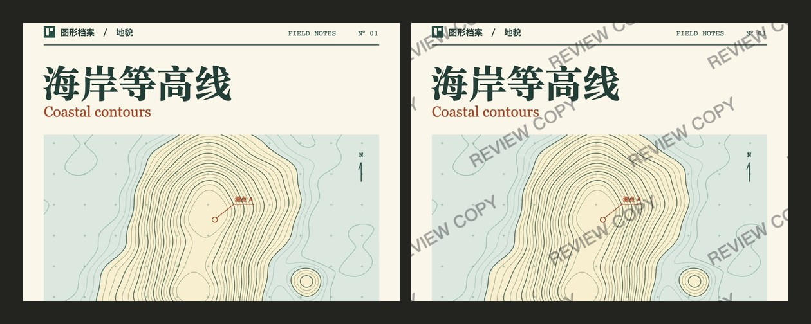

<h1 align="center"> Watermark</h1>

<p align="center">Add a repeating text watermark to a JPEG or PDF.<br>
One HTML file runs offline. Your files stay on your device.</p>

<p align="center">
  <strong><a href="https://kinoward.github.io/offline-watermark/">Open app</a></strong> &nbsp;·&nbsp;
  <strong><a href="https://github.com/kinoward/offline-watermark/releases/latest/download/Watermark.html">Download HTML</a></strong> &nbsp;·&nbsp;
  <a href="docs/en/architecture.md">How it works</a>
</p>

<p align="center">
  <a href="https://github.com/kinoward/offline-watermark/releases/latest"></a>
  <a href="https://github.com/kinoward/offline-watermark"></a>
  <a href="LICENSE"></a>
</p>

<p align="center"><strong>English</strong> · <a href="README.zh-CN.md" lang="zh-CN">简体中文</a></p>



<p align="center"><em>Original JPEG (left) · Watermarked export (right)</em></p>

## Quick start

1. **Open a file.** Launch the web app or double-click the downloaded `Watermark.html` in a recent browser. Choose one JPG, JPEG or PDF.
2. **Set the watermark.** Type one or more lines of text. Adjust size, density and opacity to see the brick pattern update in the preview. On a phone, tap the thumbnail for a closer look.
3. **Save a copy.** Choose a filename, select **Apply watermark**, then **Download**. Browsers with directory access also offer **Save to folder**. The copy keeps the original extension and defaults to a name such as `coast_水印版_01.jpg`.

<details>
<summary>See the editor on desktop, tablet and phone</summary>


On desktop, drag a file onto the workbench. On tablet, turn PDF pages while editing. On phones, the settings sit below a compact preview. [Tablet screenshot](docs/assets/tablet.jpg) · [Phone screenshot](docs/assets/phone.jpg)

</details>

## Export details

- **JPG and JPEG** are re-encoded at the quality you choose. Watermark checks dimensions, color profile, resolution, chroma sampling and baseline or progressive mode. File size and compression ratio can change, even at quality 100. **Remove EXIF data** applies the photo’s orientation to its pixels before clearing EXIF.
- **PDF** gets a tiled watermark on every page. Page sizes, rotations and existing searchable text are preserved. For an encrypted or digitally signed PDF, open a decrypted, unsigned copy.

### Privacy and languages

Files and settings stay in page memory. Refreshing clears the session. Opening the hosted app loads it from GitHub Pages, which logs visitor IP addresses. For a fully offline session, download the HTML first and then open it from disk. [GitHub Pages privacy information](https://docs.github.com/en/pages/getting-started-with-github-pages/what-is-github-pages#data-collection)

The interface starts in your browser’s preferred supported language. You can switch between English, 简体中文, 繁體中文, 日本語, 한국어, Español, Français and Русский.

## Build from source

Use Node.js **22.18 or later** on a Vite-supported release line. Run these commands from the repository root.

```sh
npm ci
npm run build:offline -- dist-offline/Watermark.html
```

Open `dist-offline/Watermark.html` directly in your browser. The architecture guide explains how TypeScript, Web Workers, ImageMagick WASM, pdf-lib and PDFium fit into one file. [Source code](src/) · [Architecture](docs/en/architecture.md) · [Build and distribution](docs/en/verification.md) · [Testing](tests/README.md)

## Contributors and license

Created by [Kino Ward (@kinoward)](https://github.com/kinoward). [All contributors](https://github.com/kinoward/offline-watermark/graphs/contributors) · [Report an issue](https://github.com/kinoward/offline-watermark/issues)

Watermark’s original code and documentation use the MIT License. Bundled components retain their own licenses, including LGPL libraries in ImageMagick WASM. Each release includes the corresponding ImageMagick source archive and rebuild instructions. [MIT License](LICENSE) · [Third-party notices](THIRD_PARTY.md) · [Release assets](https://github.com/kinoward/offline-watermark/releases/latest)
