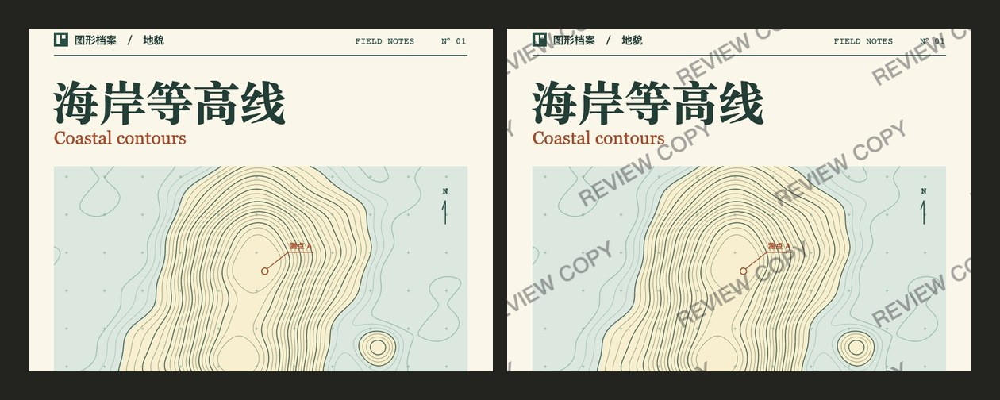
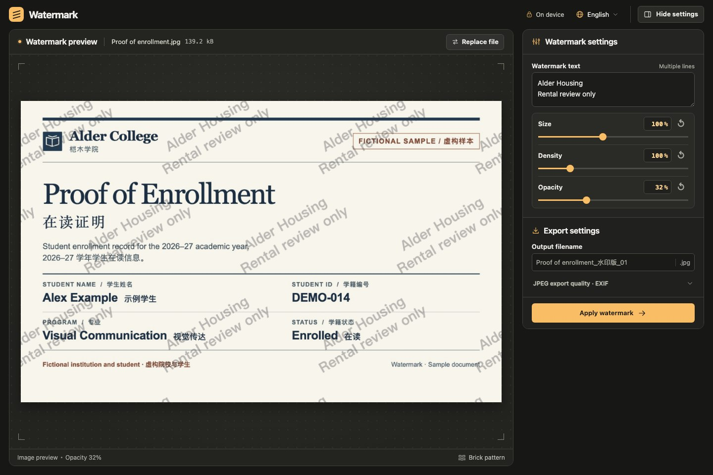

<h1 align="center"> Watermark</h1>

<p align="center">分享照片或 PDF 前，给副本加上平铺文字水印。<br>
一个 HTML 文件，本地处理，断网可用。</p>

<p align="center">
  <strong><a href="https://kinoward.github.io/offline-watermark/">在线使用</a></strong> &nbsp;·&nbsp;
  <strong><a href="https://github.com/kinoward/offline-watermark/releases/latest/download/Watermark.html">下载离线 HTML</a></strong> &nbsp;·&nbsp;
  <a href="docs/zh-CN/architecture.md">阅读技术实现</a>
</p>

<p align="center">
  <a href="https://github.com/kinoward/offline-watermark/releases/latest"></a>
  <a href="https://github.com/kinoward/offline-watermark"></a>
  <a href="LICENSE"></a>
</p>

<p align="center"><a href="README.md" lang="en">English</a> · <strong>简体中文</strong></p>



<p align="center"><em>左为 JPEG 原图，右为加水印后的同一处细节。</em></p>

## 快速上手

1. **打开文件。** 在线使用，或用浏览器打开已下载的 `Watermark.html`。每次选择一个 JPG、JPEG 或 PDF。
2. **调整水印。** 输入一行或多行文字，边看预览边调整大小、密度和透明度。文字会逐行错开，形成砖形平铺。手机上可轻点缩略图放大查看。
3. **保存副本。** 选好文件名，点击 **生成水印**，然后 **下载文件**。支持目录访问的浏览器还可选择 **保存到文件夹**。副本沿用原扩展名，默认名称类似 `海岸_水印版_01.jpg`。

<details>
<summary>查看桌面、平板和手机界面</summary>



桌面端支持拖入文件，平板上可以一边翻阅 PDF 一边调整水印，手机上则把设置放在小预览下方。[平板截图](docs/assets/tablet.jpg) · [手机截图](docs/assets/phone.jpg)

</details>

| 导入格式 | 导出行为 |
| --- | --- |
| JPG 或 JPEG | 按选定质量重新编码，核对像素尺寸、色彩配置、色度采样和编码模式。启用 **清除 EXIF 信息** 时，先把原方向应用到像素，再移除 EXIF。JPEG 文件大小和压缩率可能变化。 |
| PDF | 每页叠加平铺水印，原有文字仍可选择和搜索。加密或含数字签名的 PDF 请使用已解密的未签名副本。 |

Watermark 在浏览器里处理文件，刷新会清空任务与设置。在线版由 GitHub Pages 托管，GitHub 会记录访客 IP。全程断网使用时，打开已下载的 HTML 即可。界面根据浏览器语言初始化，支持简体中文、繁體中文、English、日本語、한국어、Español、Français 和 Русский。[GitHub Pages 数据收集说明](https://docs.github.com/en/pages/getting-started-with-github-pages/what-is-github-pages#data-collection)

## 构建和阅读源码

使用 Vite 支持的 Node.js 发行线，最低版本为 **22.18**。GitHub Actions 使用 Node.js 24。

```sh
npm ci
npm run build:offline -- dist-offline/Watermark.html
```

用浏览器直接打开 `dist-offline/Watermark.html`。

[应用源码](src/) · [架构与技术选型](docs/zh-CN/architecture.md) · [构建与分发](docs/zh-CN/verification.md) · [测试指南](tests/README.zh-CN.md)

## 许可证

Watermark 的原创代码和文档采用 MIT。HTML 内含带 LGPL 库的 ImageMagick WASM 和其他独立授权的组件。每个 Release 都附带对应的 ImageMagick 源码包及重建说明。[MIT 许可证](LICENSE) · [第三方声明](THIRD_PARTY.md) · [发行列表](https://github.com/kinoward/offline-watermark/releases)
