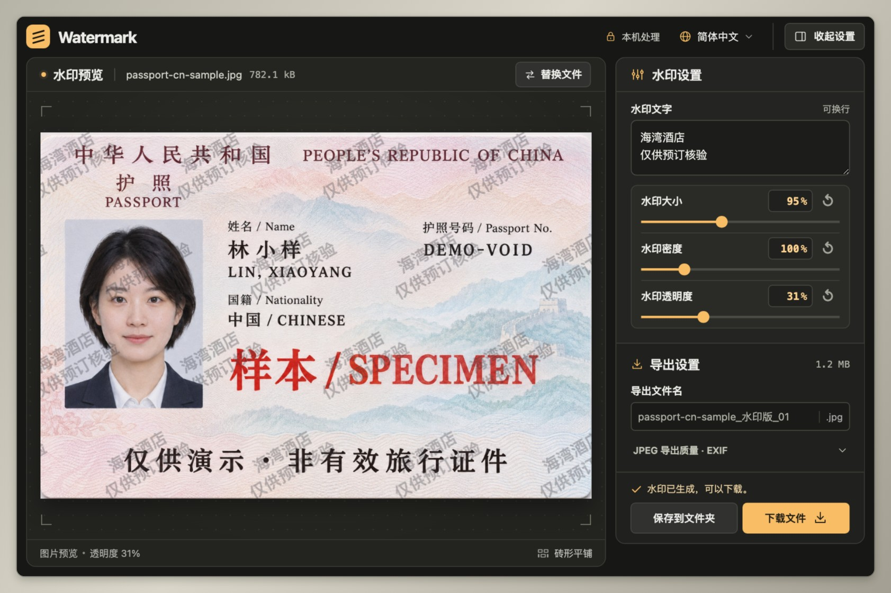

<h1 align="center"> Watermark｜离线 PDF 和 JPG 图片水印工具</h1>

<p align="center"><strong>在浏览器本地给 JPG／JPEG 图片或 PDF 的每一页添加平铺文字水印，文件无需上传。</strong><br>
可以直接在线打开，也可以下载单个 HTML 文件，断网使用。</p>

<p align="center">
  <strong><a href="https://kinoward.github.io/offline-watermark/">在线打开工具</a></strong> ·
  <a href="https://github.com/kinoward/offline-watermark/releases/latest/download/Watermark.html">下载离线 HTML</a> ·
  <a href="#实现方法">查看实现方法</a>
</p>

<p align="center"><a href="README.md" lang="en">English</a> · <strong>简体中文</strong></p>

<p align="center">
  <a href="#贡献者"></a>
  <a href="#star-历史"></a>
</p>

<p align="center">
  <a href="https://github.com/kinoward/offline-watermark/releases/latest"></a>
  <a href="#快速上手"></a>
  <a href="#开源许可"></a>
  <br>
  <a href="#导出细节"></a>
  <a href="docs/zh-CN/architecture.md"></a>
  <a href="#隐私与语言"></a>
</p>

## 快速上手

打开工具即可用内置样张试调水印。要亲自导出下图中的副本，可以先保存这张由 AI 生成的示例图片，再用编辑器打开。[保存示例图片（JPEG）](docs/assets/passport-cn-sample.jpg?raw=true)

1. **添加文件。** 选择一份 JPG、JPEG 或 PDF。离线使用时，先双击下载好的 `Watermark.html`。
2. **填写水印文字。** 要复现下图，第一行填 `海湾酒店`，第二行填 `仅供预订核验`。边看预览边调整大小、密度和透明度。
3. **生成水印 → 下载文件。** 可以保留默认名称，例如 `passport-cn-sample_水印版_01.jpg`，也可以自行命名。支持目录访问的浏览器还可选择 **保存到文件夹**。

[](https://kinoward.github.io/offline-watermark/)

<p align="center"><em>向酒店提供护照副本时，用水印写明酒店名称，注明仅供本次预订核验。</em> · <a href="docs/assets/watermark-comparison-zh-CN.jpg">对比原图与加水印的副本</a></p>

如果你想下次继续用这个离线工具，或回来查 PDF 和 JPEG 的处理代码，可以给仓库点个 Star 收藏。

### 在不同设备上使用

- **电脑**上可将文件拖入预览区打开。[桌面截图](docs/assets/desktop-zh-CN.jpg)
- **平板**上可边翻阅 PDF 边调整水印。[平板截图](docs/assets/tablet-zh-CN.jpg)
- **手机**上轻点缩略图即可放大预览。[手机截图](docs/assets/phone-zh-CN.jpg)

<a name="工作原理"></a>

## 实现方法

- **怎样给 PDF 每一页加水印，同时保留可搜索文字？** pdf-lib 在每页叠加透明图块，按页面旋转角度调整坐标，并把水印裁切在可见区域内。原有正文仍可选中，原始图片流也会保留。[PDF 叠加实现](src/pdf.ts#L109) · [从导出文件中提取正文的测试](tests/browser/smoke.mjs#L166)
- **怎样清除 JPEG 的 EXIF，又保持照片显示方向？** ImageMagick WebAssembly 先按原有方向标记旋转或翻转像素，再清除 EXIF 并重新编码。测试核对导出照片的方向、ICC 色彩配置、色度采样和渐进编码。[JPEG 编码实现](src/jpeg.ts#L25) · [EXIF 与方向测试](tests/unit/jpeg.test.mjs#L37)
- **怎样把 Web Worker 和 WebAssembly 打进一个可双击运行的 HTML？** 构建时，将包含 WASM 字节的 Worker 压缩并嵌入 HTML。使用时，浏览器按需解压，通过 Blob URL 启动 Worker。浏览器测试从本地打开 HTML，阻断 HTTP 和 HTTPS 请求后执行导出。[离线打包脚本](scripts/build-offline.mjs) · [Worker 加载器](src/processor-client-offline.ts#L4) · [断网测试](tests/browser/smoke.mjs#L24)
- **怎样让预览和导出的水印排列一致？** 两者共用图块尺寸、旋转角度和行列坐标，相邻行横向错开半格。大小控制字号，密度控制图块间距。[共用排版实现](src/layout.ts#L59) · [大小与间距测试](tests/unit/pdf.test.mjs#L130)

### 导出细节

| 格式 | 怎样添加水印 | 导出后保留什么 |
| --- | --- | --- |
| **JPEG** | ImageMagick 通过 WebAssembly 在原图分辨率下合成水印，再按所选质量重新编码。 | 工具会核对像素尺寸、色彩配置、分辨率、色度采样和基线或渐进编码模式。即使质量为 100，文件大小也可能变化。 |
| **PDF** | pdf-lib 在每一页追加透明水印图块，由浏览器或 PDFium 渲染预览。 | 保留纸张大小、旋转角度和原始图片流。原本可搜索、可选中的正文仍然可用。 |

**格式限制。** 一次处理一份 JPG、JPEG 或 PDF，JPEG 上限为 5,000 万像素。纯图片 PDF 需要另行 OCR 才能获得可搜索的文字层。处理加密或带数字签名的 PDF 时，请使用已解密、未签名的副本。

[架构与技术选型](docs/zh-CN/architecture.md) · [从源码构建](#从源码构建) · [验证与测试](tests/README.zh-CN.md)

### 隐私与语言

文件和设置只保存在页面内存里，刷新即清空。在线版由 GitHub Pages 提供，GitHub 会记录访客 IP。如需全程断网使用，先下载 HTML，再从本地打开即可。[GitHub Pages 数据收集说明](https://docs.github.com/en/pages/getting-started-with-github-pages/what-is-github-pages#data-collection)

在线编辑器和离线下载提供的是同一个 HTML 文件，都可以用发行版的校验和验证。[校验公开下载](tests/README.zh-CN.md#校验公开下载)

界面会根据浏览器语言偏好自动选择，也可手动切换简体中文、繁體中文、English、日本語、한국어、Español、Français 和 Русский。

## 从源码构建

使用 Vite 支持的 Node.js 发行线，最低版本为 **22.18**。在仓库根目录运行以下命令。

```sh
npm ci
npm run build:offline -- dist-offline/Watermark.html
```

用浏览器直接打开 `dist-offline/Watermark.html`。[应用源码](src/) · [构建与分发](docs/zh-CN/verification.md)

<a name="贡献者与许可"></a>

## 贡献者

<p>
  
  &nbsp; <strong>Kino Ward</strong> · <a href="https://github.com/kinoward">@kinoward</a>
</p>

[全部贡献者](https://github.com/kinoward/offline-watermark/graphs/contributors) · [反馈问题](https://github.com/kinoward/offline-watermark/issues)

## Star 历史

<p align="center">
  <a href="https://www.star-history.com/?repos=kinoward%2Foffline-watermark&amp;type=date">
    <picture>
      <source media="(prefers-color-scheme: dark)" srcset="https://api.star-history.com/chart?repos=kinoward/offline-watermark&amp;type=date&amp;legend=top-left&amp;theme=dark">
      
    </picture>
  </a>
</p>

页首徽章显示当前的 Star 数量。仓库在不同日期收到 Star 后，图中就会出现趋势线。[查看交互图表](https://www.star-history.com/?repos=kinoward%2Foffline-watermark&type=date)

## 开源许可

**原创代码与文档。** MIT 许可证允许个人使用和商业使用，也允许修改、分发和销售 Watermark。分发本软件的副本或其中的实质性部分时，须保留版权声明（© 2026 Watermark contributors）和许可声明。软件按现状提供，不附带担保。许可证也载明了作者和版权持有人的责任限制。[MIT 许可证全文](LICENSE)

**分发离线 HTML。** JPEG 和 PDF 处理库各有自己的许可条款。打开 `Watermark.html` 的源码并搜索 `third-party-licenses`，即可查看随附声明。ImageMagick WASM 静态链接了多个 LGPL 库。HTML 文件顶部标有对应的发行版本，可从该版本下载 `ImageMagick-WASM-source.tar.gz`，取得匹配的源码以及重建、替换模块的说明。[第三方许可清单](THIRD_PARTY.md) · [重建说明](third-party/imagemagick/README.md) · [各版本发行附件](https://github.com/kinoward/offline-watermark/releases)
