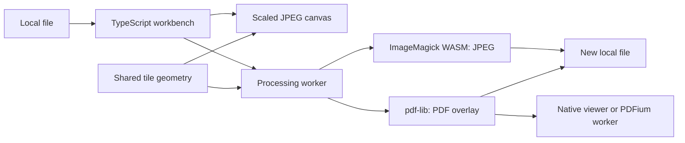

# Architecture and decisions

[Home](../../README.md) · [简体中文](../zh-CN/architecture.md) · [Build and distribution](verification.md) · [Test guide](../../tests/README.md)

## One file for distribution, one file at a time for editing

Watermark started as a browser tool for temporary work on local documents and photos. A static app can accept a user-selected file, process it in a worker and offer a download with no backend. Building a single HTML also means that copying the app to another computer is enough to run it. Files, settings, worker state and generated results live in memory for the lifetime of the page.

The early design had a queue and a preview selector. The final workflow keeps one active file so that the preview, the export name and the result always refer to the same source. JPG, JPEG and PDF are the supported inputs. PNG remains an internal representation for transparent watermark tiles.

[Application state](../../src/main.ts) · [Worker request and response types](../../src/processing.ts)

## Package the app for `file://`

[Vite](https://vite.dev/) builds the HTML, CSS and TypeScript. The offline build inlines the page bundle. It gzip-compresses the two Worker scripts and two original WASM binaries separately and embeds each as Base64. At runtime `DecompressionStream` unpacks each Worker script on demand and the page starts it as a classic Blob Worker, which supports `file://` in WebKit. On the first job that uses each codec, the page transfers the compressed WASM to its Worker, where the codec initializes directly from the decompressed bytes. The build checks that the result needs no additional files.

JPEG’s WASM decoder/encoder initializes on its first use. PDF export and raster preview are separate jobs. PDFium loads when the canvas page reader is used. WebKit can create a PNG Blob in a `file://` worker and then fail with `NotReadableError` when reading it. In that situation the tile code gives the same RGBA pixels to UPNG instead. Embedded fonts would increase the download size, so the app uses local browser fonts for watermark text.

[Offline build](../../scripts/build-offline.mjs) · [Worker loader](../../src/processor-client-offline.ts) · [Canvas tile and fallback](../../src/layout.ts)

## Share tile geometry across formats

The layout splits text into lines, measures the widest line and rotates a transparent text tile by −30°. It derives the tile size from the shorter edge of each page or image and offsets every other row by half a step. Watermark size controls glyph scale, density controls the gap, and opacity applies to the tile ink. The sample, photo preview, JPEG encoder and PDF overlay all use this geometry. The preview uses a reduced canvas while the JPEG export composites at source resolution.

The size range is 25–200%, the density range is 50–300%, and the opacity range is 1–100%. Sliders share values with keyboard inputs and individual resets. The interface hides JPEG quality and EXIF tools for PDF work.

[Tile layout and EXIF transforms](../../src/layout.ts) · [Settings and defaults](../../index.html) · [Size and density tests](../../tests/unit/pdf.test.mjs)

## JPEG re-encoding and metadata checks

Browser canvas encoding can draw the mark, but exposes too little control over sampling, progressive scans and metadata. ImageMagick WASM supplies the encoder controls. Watermark parses JPEG markers, builds an overlay in the source orientation, composites and re-encodes, then restores the declared JFIF density, supported EXIF and ICC segments. It inspects the output to detect changes in dimensions, components, sampling, coding mode and orientation. Standard embedded thumbnails are dropped because they would still show the original.

Quality 100 uses the encoder’s highest quality setting. The encoder selects quantization tables for that setting, so compressed bytes, file size and compression ratio can change. The output keeps the original pixel dimensions when EXIF is retained. With EXIF removal enabled, rotations and mirrors are applied to the pixels and a 90° or 270° transform can swap stored width and height. This option removes the EXIF segment and preserves supported color and density information. Some JPEG variants, including CMYK and compound or HDR images carrying unsupported markers, and files above 50 megapixels report an error.

[ImageMagick JPEG options](https://github.com/ImageMagick/Usage-Markdown/blob/main/formats/index.md#writing-jpeg-control-options) · [Encoder](../../src/jpeg.ts) · [Marker checks and restoration](../../src/jpeg-metadata.ts) · [JPEG tests](../../tests/unit/jpeg.test.mjs)

## A new watermark layer on each PDF page

[Comparison research](https://github.com/alam00000/bentopdf) showed the practicality of applying a transparent tile with an existing PDF library. The implementation here uses [pdf-lib](https://github.com/Hopding/pdf-lib) to append drawing operations and an image XObject. It intersects the CropBox with the MediaBox, maps display coordinates through page rotation, clips to the visible area and copies shared resource and content-array containers before editing them. The serializer rewrites the PDF file while retaining original page boxes and compressed content and image streams. Existing selectable text remains selectable. The rendered watermark itself is a transparent raster image.

The app detects encryption, signed fields, timestamp signatures and document certification and asks for a suitable source copy. A blank signature field is allowed. Source documents with missing CJK font data can render differently in the PDFium preview, which shows a notice and offers the full preview file through the browser. The export retains the source font objects.

[PDF overlay](../../src/pdf.ts) · [PDF structure tests](../../tests/unit/pdf.test.mjs) · [Font detection](../../src/pdf-fonts.ts)

## Preview and input across devices

The JPEG preview schedules canvas paints at intervals of at least 50 ms. A PDF update waits for 300 ms of idle input. A revision counter prevents an older job from replacing a newer preview, and the previous PDF stays visible until a replacement is ready. Desktop uses the browser’s PDF viewer where available. On smaller or touch layouts, PDFium rasterizes the visible page in a separate Worker. The reader reuses the loaded document when turning a page and keeps the page number across zoom, rotation and viewport changes.

On phones, the editor is the main surface and the preview opens in a dismissible dialog. Tablets stack the panes in portrait and use two columns in wide landscape. The desktop layout reserves most of the screen for the preview and has a file drop target. If a native PDF viewer captures a drop, the desktop toolbar has a separate drop area. Layout changes move the existing controls and restore focus when a control must be reparented. CSS and the Web Animations API provide transitions with a reduced-motion path.

[Preview scheduling](../../src/preview.ts) · [PDF reader](../../src/pdf-reader.ts) · [Responsive state](../../src/main.ts) · [Tablet styles](../../src/tablet.css)

## Language, saving and privacy

Language selection reads `navigator.languages` in preference order, including Chinese script variants, and falls back to English. Language changes last until refresh. Watermark text, selected files and generated results are held in memory. The app sends no file data to the host.

When the native file and directory pickers are available, the source handle suggests the opening location for the save picker. It remains the user’s choice. The save routine looks for conflicts in the selected folder, advances the default suffix and rejects a conflicting custom name. The standard browser download uses browser settings to choose the destination and handle existing names. Directory collision checks cover this app’s own save flow. The browser API offers no atomic exclusive-create operation against other concurrent writers to that folder.

[Language selection](../../src/i18n.ts) · [File handling](../../src/file-io.ts) · [Naming and directory tests](../../tests/unit/file-io.test.mjs)
