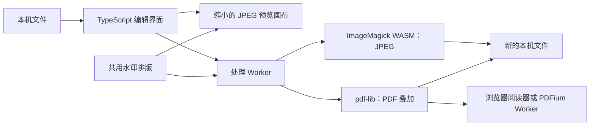

# 架构与技术选型

[首页](../../README.zh-CN.md) · [English](../en/architecture.md) · [构建与分发](verification.md) · [测试指南](../../tests/README.zh-CN.md)

## 单 HTML 分发，一次编辑一个文件

Watermark 用于临时给本机的文档和照片加水印。静态网页可以读取用户选择的文件，在 Worker 中处理，再交给浏览器下载，省去后端服务。把单个 HTML 复制到另一台电脑即可打开使用。文件、设置、Worker 状态和成品都留在当前页面内存中。

早期界面曾有处理队列和预览切换器。最终只维护一个活动文件，让预览、导出名称和结果始终对应同一个源文件。支持的输入是 JPG、JPEG 和 PDF。PNG 用于内部保存透明水印图块。

[页面状态](../../src/main.ts) · [Worker 请求与返回类型](../../src/processing.ts)

## 让构建结果可以通过 `file://` 打开

[Vite](https://vite.dev/) 构建 HTML、CSS 和 TypeScript。离线构建将页面内联，对两段 Worker 脚本和两份原始 WASM 二进制分别执行 gzip 压缩和 Base64 编码，再嵌入 HTML。运行时通过 `DecompressionStream` 按需解包脚本，由页面通过 Blob URL 启动经典 Worker，兼容 WebKit 的 `file://` 场景。首次使用某个编解码器时，页面将对应的压缩 WASM 转移给 Worker，直接用解压后的字节初始化。构建过程会检查产物是否依赖其他文件。

首次处理 JPEG 时初始化它的 WASM 编解码器。PDF 导出与页面预览独立运行，用画布预览时才加载 PDFium。WebKit 在 `file://` 下可以从 Worker 画布生成 PNG Blob，读取时有时会报 `NotReadableError`。遇到该错误时，将同一份 RGBA 像素交给 UPNG 编码。水印文字使用浏览器本机字体，以控制下载体积。

[离线构建脚本](../../scripts/build-offline.mjs) · [Worker 加载器](../../src/processor-client-offline.ts) · [图块绘制和回退](../../src/layout.ts)

## 图片和 PDF 共用水印排版

排版先按换行拆分文字，测量最长行的宽度，生成倾斜 −30° 的透明文字图块。每张照片或每页 PDF 以可见区域的短边计算图块大小，每隔一行横向错开半格。水印大小控制字的比例，密度控制图块间距，透明度控制文字墨色。样张、照片预览、JPEG 导出和 PDF 叠加都使用这套几何规则。预览用缩小的画布绘制，JPEG 导出在原始像素分辨率上合成。

大小范围为 25–200%，密度为 50–300%，透明度为 1–100%。滑块与数字输入同步，各自可以重置。处理 PDF 时隐藏 JPEG 质量和 EXIF 设置。

[图块排版和 EXIF 坐标变换](../../src/layout.ts) · [参数范围和默认值](../../index.html) · [大小与密度测试](../../tests/unit/pdf.test.mjs)

## JPEG 的重新编码、元数据恢复和核对

浏览器 Canvas 可以画水印，但控制色度采样、渐进模式和元数据的能力有限。ImageMagick WASM 提供所需的编码选项。Watermark 解析 JPEG 标记，根据源照片的显示方向布置水印，合成并重新编码，然后恢复已声明的 JFIF 密度、受支持的 EXIF 和 ICC 段。导出前再检查尺寸、色彩分量、采样、编码模式和方向。标准内嵌缩略图会被移除，因为其中还是原图。

质量 100 表示编码器的最高质量设置。新量化表会改变压缩数据，文件大小和压缩倍率可能随之变化。保留 EXIF 时，原始像素尺寸不变。清除 EXIF 时，先将镜像或旋转应用到像素，再移除 EXIF 段。90° 或 270° 旋转可能交换存储的宽和高，显示方向与源图一致。受支持的色彩和密度信息仍会保留。对 CMYK、带不支持标记的复合或 HDR JPEG，以及超过 5000 万像素的图片会提示错误。

[ImageMagick JPEG 编码选项](https://github.com/ImageMagick/Usage-Markdown/blob/main/formats/index.md#writing-jpeg-control-options) · [编码实现](../../src/jpeg.ts) · [标记校验和恢复](../../src/jpeg-metadata.ts) · [JPEG 测试](../../tests/unit/jpeg.test.mjs)

## PDF 逐页追加水印层

调研时，[BentoPDF](https://github.com/alam00000/bentopdf) 展示了利用现有 PDF 库叠加水印图块的可行性。本项目用 [pdf-lib](https://github.com/Hopding/pdf-lib) 添加图像 XObject 与绘制指令，取 CropBox 和 MediaBox 的交集，按页面旋转将显示坐标映射回页面坐标，并在可见区域内裁切。写入前复制共享的资源字典和内容数组容器，避免修改影响其他页面。导出时 PDF 容器重新序列化，原页面边界、原有内容流和内嵌图片流的压缩数据得到保留。原文字仍可选择和检索，新增水印以透明图像叠加。

工具检测加密、已签名字段、文档签名时间戳和认证签名，提示换用合适的副本。空白签名字段仍可处理。没有嵌入中日韩字体的源页可能在 PDFium 预览中显示不同，工具会提示并提供通过浏览器打开完整预览的入口。输出保留源文档的字体对象。

[PDF 叠加实现](../../src/pdf.ts) · [PDF 结构测试](../../tests/unit/pdf.test.mjs) · [字体检测](../../src/pdf-fonts.ts)

## 预览调度和不同设备的交互

JPEG 预览将画布重绘间隔限制在至少 50 毫秒。PDF 等输入停顿 300 毫秒再更新，使用修订序号防止旧任务覆盖新结果，保留上一版直到新预览可显示。电脑端在浏览器支持时使用内置阅读器。小窗口和触屏布局用 PDFium 在独立 Worker 中渲染当前页。翻页会复用已加载文档，放大、旋转屏幕或调整窗口后保留当前页码。

手机以设置为主，点击缩略图后打开可点空白处退出的放大预览。平板竖屏上下排布，宽横屏采用双栏。电脑端预览占主要空间并可拖入文件。若浏览器内置的 PDF 阅读器接管拖放，可用预览工具栏中的独立拖入区。断点变化时移动同一组控件，必要时恢复输入焦点。CSS 与 Web Animations API 提供过渡，并响应减少动态效果的系统设置。

[预览调度](../../src/preview.ts) · [PDF 页面阅读器](../../src/pdf-reader.ts) · [响应式状态](../../src/main.ts) · [平板样式](../../src/tablet.css)

## 语言、保存和隐私

语言按 `navigator.languages` 的偏好顺序匹配，区分简繁体，找不到匹配时使用英语。手动切换语言保持到刷新为止。水印文字、导入文件和成品都保存在当前页面内存中，应用不向主机发送文件数据。

浏览器支持原生文件和目录选择器时，源文件句柄可用来建议保存对话框的起始位置，最终目录由用户选择。写入前检查所选目录中的同名项，遇到默认名冲突时增加序号，自定义名冲突则提示改名。普通下载的目录和重名处理由浏览器设置决定。授权目录的冲突检查覆盖应用自己的保存流程，浏览器 API 没有提供与其他进程并发时的原子独占创建操作。

[语言匹配](../../src/i18n.ts) · [文件操作](../../src/file-io.ts) · [命名和目录测试](../../tests/unit/file-io.test.mjs)
